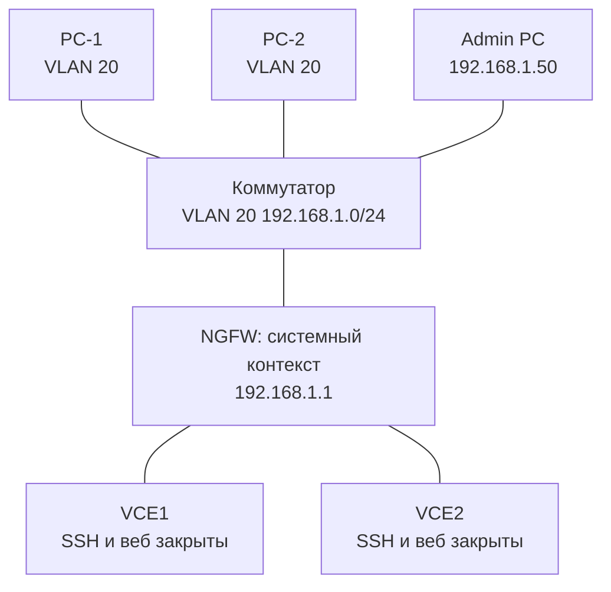

# 1.1. L2, общий VLAN с пользовательским сегментом

**Цель:** доступ к управлению NGFW по IP системного контекста прямо из пользовательской подсети.

_Адресация на схемах — пример (RFC1918), подставьте свою._

```text
  Пользователи VLAN 20                   Админ (тоже VLAN 20)
  192.168.1.0/24                          192.168.1.50
  +--------+ +--------+                   +-----------+
  | PC-1   | | PC-2   |                   | Admin PC  |
  +---+----+ +---+----+                   +-----+-----+
      |          |                              |
  +---+----------+------------------------------+---+
  |            Коммутатор доступа, VLAN 20          |
  +------------------------+------------------------+
                           |
                 port1 (системный контекст)
                 192.168.1.1/24  <- веб и API управления
                 +---------+----------+
                 |  Ideco NGFW Novum  |
                 |  +------+ +------+ |
                 |  | VCE1 | | VCE2 | |  VCE: SSH и веб закрыты
                 |  +------+ +------+ |
                 +--------------------+
```



**Что даёт**

- Самый простой запуск: ничего не нужно настраивать на коммутаторе.
- Работает сразу после обновления до 23.4.40 — доступ через системный контекст.
- Подходит только для лаборатории или стенда Vagrant.

**Что ломает / риски**

- Нулевая изоляция: любой в подсети видит веб-интерфейс и API управления.
- Нет резервирования: отказ порта или коммутатора — потеря управления.
- Широковещательный и пользовательский трафик делит один L2-домен с управлением.
- Компрометация любого ПК даёт прямой путь к интерфейсу управления.

**На что обратить внимание**

- Не рекомендуется для продакшена.
- Если временно используется — ограничьте доступ к управлению по IP админов правилами на системном контексте.
- Oxidized и Redbox API должны ходить на mgmt-IP системного контекста, а не на VCE: с 23.4.40 у VCE закрыты SSH и собственный веб.
- Используйте эту схему только как переходную к 1.2–1.4.
