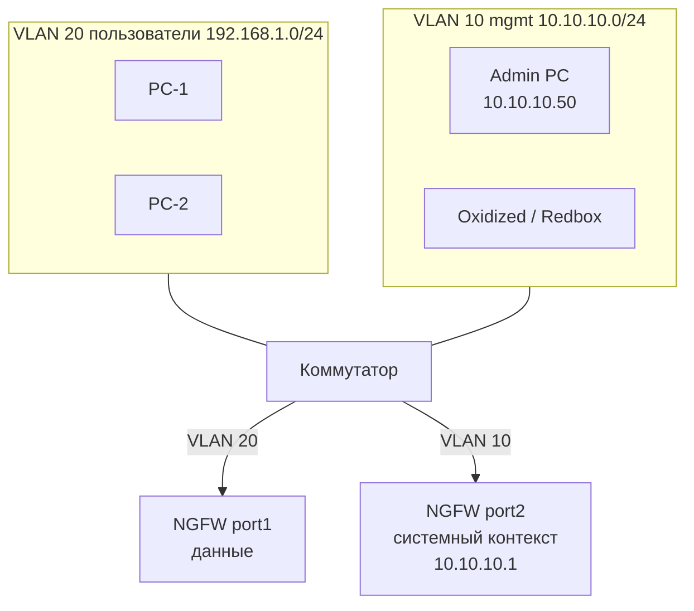

# 1.2. L2, выделенный менеджмент-VLAN на том же коммутаторе

**Цель:** отделить управление от пользователей отдельным VLAN 10 на том же коммутаторе.

_Адресация на схемах — пример (RFC1918), подставьте свою._

```text
  Пользователи VLAN 20             Админы VLAN 10 (mgmt)
  192.168.1.0/24                   10.10.10.0/24
  +--------+ +--------+            +-----------+ +-----------+
  | PC-1   | | PC-2   |            | Admin PC  | | Oxidized/ |
  +---+----+ +---+----+            |10.10.10.50| | Redbox    |
      |          |                 +-----+-----+ +-----+-----+
      |          |                       |             |
  +---+----------+-----------------------+-------------+---+
  |  Коммутатор: access VLAN 20 | access VLAN 10            |
  +----------+------------------------------+--------------+
             | VLAN 20                      | VLAN 10
        port1 (данные)              port2 (системный контекст)
             |                       10.10.10.1/24
       +-----+------------------------------+-----+
       |              Ideco NGFW Novum            |
       +------------------------------------------+
```



**Что даёт**

- Базовая изоляция управления от пользовательского трафика.
- Минимум изменений: один новый VLAN и один порт.
- Понятная точка для правил доступа: только VLAN 10.

**Что ломает / риски**

- Нет резервирования пути: один коммутатор и один порт.
- Изоляция только логическая — ошибка в конфигурации VLAN на коммутаторе открывает доступ.
- Если VLAN 10 маршрутизируется с пользовательскими сетями, изоляция теряется.

**На что обратить внимание**

- Не маршрутизируйте VLAN 10 в пользовательские сети без фильтрации.
- Админские хосты держите только в VLAN 10 или пускайте через jump-host.
- Oxidized и Redbox API должны ходить на mgmt-IP системного контекста, а не на VCE: с 23.4.40 у VCE закрыты SSH и собственный веб.
- Проверьте, что порт управления — access VLAN 10, без лишних VLAN в trunk.
