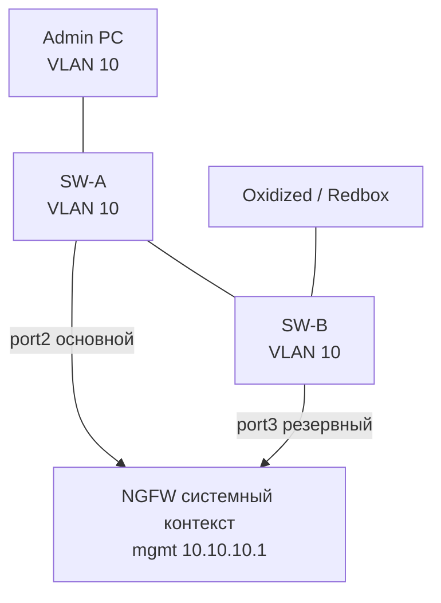

# 1.3. L2, выделенный VLAN через отдельный физический порт или коммутатор

**Цель:** второй порт системного контекста в mgmt-VLAN через другой физический путь.

_Адресация на схемах — пример (RFC1918), подставьте свою._

```text
               Админы VLAN 10 (mgmt) 10.10.10.0/24
               +-----------+   +-----------------+
               | Admin PC  |   | Oxidized/Redbox |
               +-----+-----+   +--------+--------+
                     |                  |
          +----------+------+    +------+----------+
          |  SW-A  VLAN 10  +----+  SW-B  VLAN 10  |   (связь SW-A/SW-B,
          +--------+--------+    +--------+--------+    или общий агрегатор)
                   |                      |
            port2 (основной)        port3 (резервный)
                   |                      |
          +--------+----------------------+--------+
          |   системный контекст: mgmt 10.10.10.1  |
          |   (bond/резерв двух портов, пример)    |
          |            Ideco NGFW Novum            |
          +----------------------------------------+
```



**Что даёт**

- Изоляция управления в отдельном VLAN.
- Базовое резервирование канала: отказ одного коммутатора или кабеля не отрезает управление.
- Один IP управления — простая настройка клиентов и Oxidized.

**Что ломает / риски**

- Если оба порта в одном L2 без агрегации или STP, возможна петля.
- Резервирование только на L2: отказ самого mgmt-VLAN или его шлюза не покрыт.
- Сложнее, чем 1.2: нужен второй коммутатор или аплинк.

**На что обратить внимание**

- Способ объединения двух портов (агрегация или резервирование) проверьте в документации Ideco для вашей версии.
- Проверьте failover: отключите основной кабель и убедитесь, что веб и API доступны.
- Oxidized и Redbox API должны ходить на mgmt-IP системного контекста, а не на VCE: с 23.4.40 у VCE закрыты SSH и собственный веб.
- Рекомендуемая схема для одного NGFW без Center.
