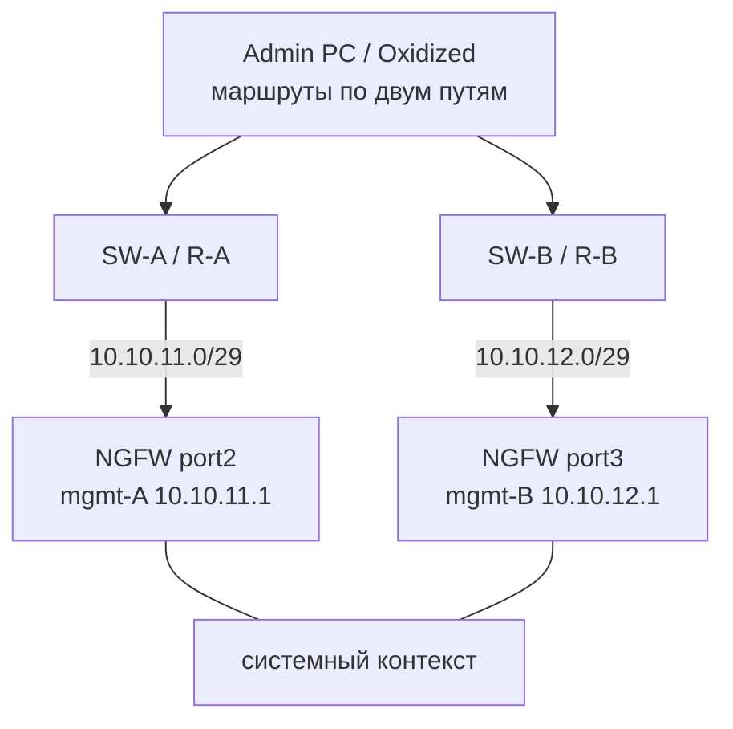

# 1.4. Два менеджмент-IP в разных подсетях

**Цель:** два независимых пути управления: два IP системного контекста в разных подсетях через два коммутатора.

_Адресация на схемах — пример (RFC1918), подставьте свою._

```text
                         +---------------------+
                         |  Admin PC / Oxidized|
                         |  маршруты:          |
                         |  10.10.11.0/29 -> A |
                         |  10.10.12.0/29 -> B |
                         +----+-----------+----+
                              |           |
                     +--------+--+     +--+--------+
                     |  SW-A /   |     |  SW-B /   |
                     |  R-A      |     |  R-B      |
                     +-----+-----+     +-----+-----+
                           |                 |
              10.10.11.0/29|                 |10.10.12.0/29
              .1 = NGFW    |                 |    .1 = NGFW
                     port2 |                 | port3
                     +-----+-----------------+-----+
                     |  системный контекст NGFW    |
                     |  mgmt-A 10.10.11.1          |
                     |  mgmt-B 10.10.12.1          |
                     +-----------------------------+
```



**Что даёт**

- Полное резервирование: независимые порты, коммутаторы и подсети.
- Failover на уровне маршрутизации, без L2-петель.
- Можно разнести пути по разным площадкам или стойкам.

**Что ломает / риски**

- Два адреса управления: в Oxidized, Redbox и закладках нужно учитывать оба.
- Асимметричная маршрутизация, если ответы NGFW уходят не тем путём.
- Сложнее в эксплуатации и документировании.

**На что обратить внимание**

- На NGFW проверьте, что ответ уходит через тот же интерфейс, через который пришёл запрос.
- Для Oxidized укажите основной IP, а резервный — как запасной вариант (или DNS-имя с проверкой).
- Oxidized и Redbox API должны ходить на mgmt-IP системного контекста, а не на VCE: с 23.4.40 у VCE закрыты SSH и собственный веб.
- Рекомендуемая схема для одного NGFW без Center, если нужна полная отказоустойчивость.
