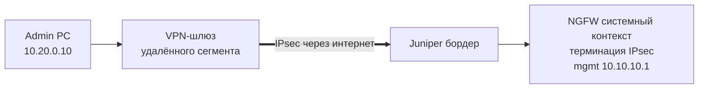

# 1.5. Менеджмент через IPsec-туннель

**Цель:** доступ к управлению из удалённой админской сети по IPsec, терминированному на системном контексте.

_Адресация на схемах — пример (RFC1918), подставьте свою._

```text
  Удалённый админ-сегмент              Интернет           Площадка
  (дом. офис / другой сегмент)                            
  10.20.0.0/24 (пример)
  +-----------+   +---------+                        +--------------+
  | Admin PC  +---+ VPN-GW  +====== IPsec ==========+  Juniper     |
  |10.20.0.10 |   +---------+                        |  (бордер)    |
  +-----------+   203.0.113.10 (пример)              +------+-------+
                                                            |
                                          WAN системного контекста
                                          198.51.100.2 (пример)
                                          +-----------------+-------+
                                          | Ideco NGFW: системный   |
                                          | контекст, туннель и     |
                                          | mgmt 10.10.10.1         |
                                          +-------------------------+
```



**Что даёт**

- Управление не зависит от физической топологии площадки.
- Удалённый доступ без открытия веб-интерфейса в интернет.
- Шифрование трафика управления.

**Что ломает / риски**

- Отказ туннеля или WAN — потеря управления; нужен запасной локальный путь.
- Ошибка в настройке IPsec может отрезать управление удалённо — меняйте с осторожностью.
- IKE/IPsec-порты на внешнем интерфейсе — дополнительная поверхность атаки.

**На что обратить внимание**

- Пропустите IKE и ESP (или NAT-T) через Juniper до системного контекста.
- В туннель включайте только админские сети, не весь удалённый сегмент.
- Oxidized и Redbox API должны ходить на mgmt-IP системного контекста, а не на VCE: с 23.4.40 у VCE закрыты SSH и собственный веб.
- Держите локальный запасной путь (1.2–1.4) на случай проблем с туннелем.
