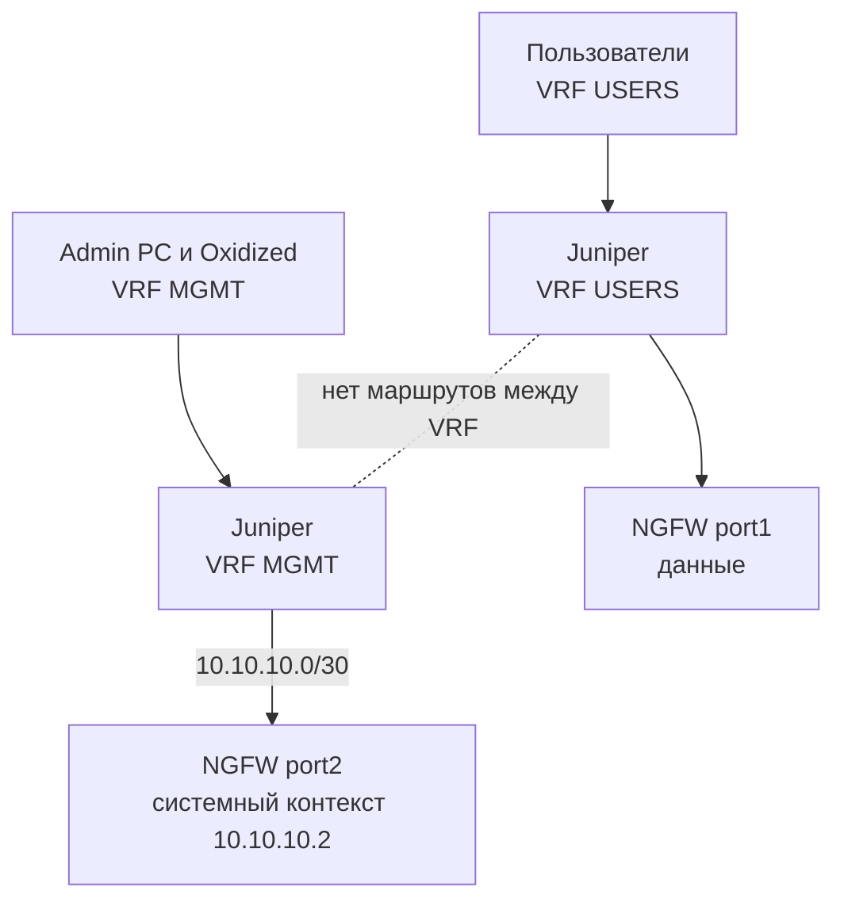

# 1.6. Менеджмент через отдельный VRF на Juniper

**Цель:** изоляция управления на L3: mgmt-порт NGFW в отдельном VRF на Juniper-бордере.

_Адресация на схемах — пример (RFC1918), подставьте свою._

```text
     VRF USERS                              VRF MGMT
     192.168.1.0/24                          10.10.10.0/24
  +-------------+                        +-------------+  +-----------------+
  | Пользователи|                        | Admin PC    |  | Oxidized/Redbox |
  +------+------+                        +------+------+  +--------+--------+
         |                                      |                  |
  +------+--------------------------------------+------------------+-------+
  |  Juniper (бордер)                                                      |
  |  [ VRF USERS ]  -- нет маршрутов между VRF --  [ VRF MGMT ]            |
  +------+-------------------------------------------------+---------------+
         | ge-0/0/1 (USERS)                                | ge-0/0/2 (MGMT)
         |                                                 | 10.10.10.0/30
   port1 (данные)                               port2 системный контекст
         +---------------------+---------------------------+
                               |
                    +----------+------------------------+
                    | Ideco NGFW Novum, mgmt 10.10.10.2 |
                    +-----------------------------------+
```



Пример (условный, только иллюстрация) VRF на Junos:

```text
routing-instances {
    MGMT {
        instance-type vrf;
        interface ge-0/0/2.0;
        route-distinguisher 65000:10;
        vrf-target target:65000:10;
    }
}
```

**Что даёт**

- Изоляция на L3: из пользовательских VRF управление не видно.
- Централизованная политика на Juniper, легко расширять на другие устройства.
- Хорошо сочетается со схемами 1.4 и 2.4.

**Что ломает / риски**

- Ошибочный route leaking между VRF ломает изоляцию.
- Juniper становится единой точкой отказа для управления, если он один.
- Сложнее диагностика: нужно учитывать таблицу маршрутов VRF.

**На что обратить внимание**

- Не делайте утечку маршрутов из VRF MGMT в пользовательские VRF.
- Oxidized, Redbox и админские хосты должны быть в VRF MGMT. Oxidized и Redbox API должны ходить на mgmt-IP системного контекста, а не на VCE: с 23.4.40 у VCE закрыты SSH и собственный веб.
- Сниппет ниже — минимальный пример, имена и адреса условные.
