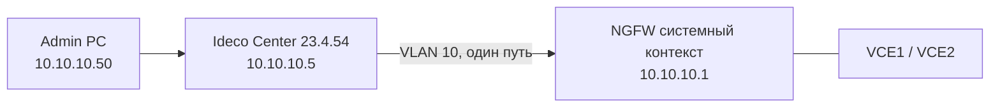

# 2.1. Ideco Center в менеджмент-VLAN, NGFW по одному пути

**Цель:** единая точка управления: админы ходят в Ideco Center 23.4.54, Center управляет NGFW через системный контекст.

_Адресация на схемах — пример (RFC1918), подставьте свою._

```text
          Админы VLAN 10                 
          +-----------+     https       +---------------------+
          | Admin PC  +---------------->+ Ideco Center 23.4.54|
          |10.10.10.50|                 | 10.10.10.5          |
          +-----+-----+                 +----------+----------+
                |                                  |
          +-----+----------------------------------+-----+
          |          Коммутатор, VLAN 10 (mgmt)          |
          +----------------------+-----------------------+
                                 | один путь
                       port2 системный контекст 10.10.10.1
                       +---------+---------+
                       |  Ideco NGFW Novum |
                       |  VCE1   VCE2      |  VCE управляются
                       +-------------------+  через Center/систем.
```



**Что даёт**

- Единая точка входа для админов и для управления VCE.
- Удобно при росте числа NGFW.
- Доступ к NGFW напрямую можно сузить до Center.

**Что ломает / риски**

- Нет резерва: отказ Center, порта или коммутатора — потеря централизованного управления.
- Center становится критичным активом: его компрометация даёт доступ ко всем NGFW.
- Зависимость от совместимости версий Center и NGFW.

**На что обратить внимание**

- Оставьте аварийный прямой доступ к системному контексту из VLAN 10.
- Совместимость Center 23.4.54 и NGFW 23.4.40 проверьте по документации Ideco.
- Oxidized и Redbox API должны ходить на mgmt-IP системного контекста (или на Ideco Center, если он используется как точка интеграции), а не на VCE: с 23.4.40 у VCE закрыты SSH и собственный веб.
- Защитите доступ к Center (AD-группы админов, ограничение по IP).
