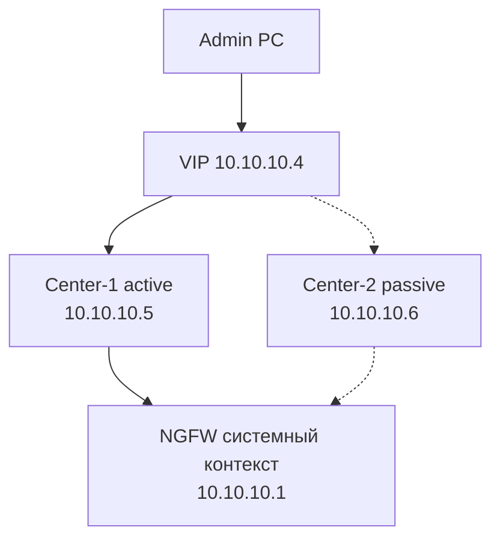

# 2.2. Ideco Center HA-пара + NGFW

**Цель:** резервирование точки управления: два Center в режиме active-passive в mgmt-VLAN.

_Адресация на схемах — пример (RFC1918), подставьте свою._

```text
          Админы VLAN 10
          +-----------+
          | Admin PC  +-------------+  https на VIP 10.10.10.4 (пример)
          +-----------+             |
                         +----------+----------+
                         |   VIP 10.10.10.4    |
            +------------+-------+     +-------+------------+
            | Center-1 (active)  |     | Center-2 (passive) |
            | 10.10.10.5         |     | 10.10.10.6         |
            +---------+----------+     +----------+---------+
                      |                           |
          +-----------+---------------------------+--------+
          |               Коммутатор, VLAN 10              |
          +-----------------------+------------------------+
                                  |
                  port2 системный контекст 10.10.10.1
                          +-------+--------+
                          | Ideco NGFW     |
                          +----------------+
```



**Что даёт**

- Резервирование точки управления: отказ одного Center не останавливает управление.
- Админы и интеграции работают с одним адресом (VIP).
- Можно обслуживать Center по очереди.

**Что ломает / риски**

- Путь до NGFW по-прежнему один — отказ порта NGFW или коммутатора не покрыт.
- Риск split-brain при потере связи между узлами пары.
- Удвоение ресурсов и сложности обновления.

**На что обратить внимание**

- Поддерживает ли Center 23.4.54 HA, как он устроен и как NGFW подключается (к VIP или к обоим узлам) — проверьте в документации Ideco; схема обобщённая.
- Тестируйте переключение active -> passive до ввода в эксплуатацию.
- Oxidized и Redbox API должны ходить на mgmt-IP системного контекста (или на Ideco Center (по VIP), если он используется как точка интеграции), а не на VCE: с 23.4.40 у VCE закрыты SSH и собственный веб.
- Разнесите узлы по разным хостам или стойкам.
