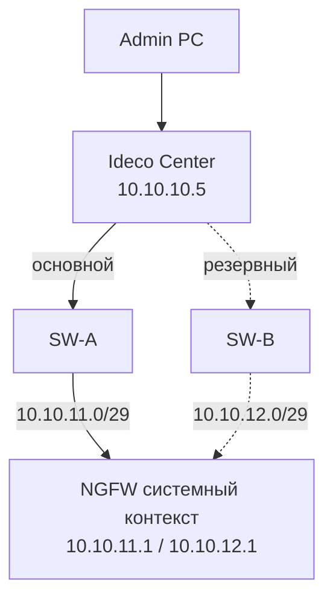

# 2.3. Ideco Center + NGFW с двумя менеджмент-портами

**Цель:** NGFW имеет основной и резервный mgmt-IP, Center видит оба; при отказе основного пути используется запасной.

_Адресация на схемах — пример (RFC1918), подставьте свою._

```text
                     +---------------------+
   Admin PC -------->+ Ideco Center        |
                     | 10.10.10.5          |
                     +-----+---------+-----+
                           |         |
                    +------+--+   +--+------+
                    |  SW-A   |   |  SW-B   |
                    +----+----+   +----+----+
              основной   |             |  резервный
           10.10.11.0/29 |             | 10.10.12.0/29
                   port2 |             | port3
                    +----+-------------+----+
                    | системный контекст    |
                    | 10.10.11.1 (основной) |
                    | 10.10.12.1 (резерв)   |
                    |   Ideco NGFW Novum    |
                    +-----------------------+
```



**Что даёт**

- Резервирование пути между Center и NGFW.
- Аварийный доступ админов к NGFW по второму адресу.
- Можно обслуживать один коммутатор без потери управления.

**Что ломает / риски**

- Center остаётся одиночной точкой отказа.
- Нужно, чтобы Center умел работать с двумя адресами NGFW, иначе переключение ручное.
- Асимметрия маршрутов при неверной маршрутизации на NGFW.

**На что обратить внимание**

- Как Center обрабатывает несколько адресов одного NGFW — проверьте в документации Ideco.
- Маршруты от Center до обеих подсетей должны быть независимыми.
- Oxidized и Redbox API должны ходить на mgmt-IP системного контекста (или на Ideco Center, если он используется как точка интеграции), а не на VCE: с 23.4.40 у VCE закрыты SSH и собственный веб.
- Проверьте failover отключением основного пути.
