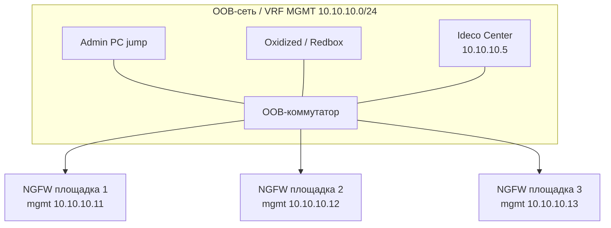

# 2.4. Ideco Center в out-of-band сегменте или отдельном VRF

**Цель:** максимальная изоляция: Center и mgmt всех NGFW в отдельной OOB-сети, не пересекающейся с продакшеном.

_Адресация на схемах — пример (RFC1918), подставьте свою._

```text
            OOB-сеть 10.10.10.0/24 (отдельный свитч или VRF MGMT)
  +-----------+  +-----------------+  +-------------------------+
  | Admin PC  |  | Oxidized/Redbox |  | Ideco Center 10.10.10.5 |
  | (jump)    |  |                 |  |                         |
  +-----+-----+  +--------+--------+  +-----------+-------------+
        |                 |                       |
  +-----+-----------------+-----------------------+----------+
  |           OOB-коммутатор / VRF MGMT на Juniper            |
  +------+----------------------+--------------------+-------+
         | 10.10.10.0/24 или /30 по площадкам (пример)
  +------+------+        +------+------+      +------+------+
  | NGFW пл. 1  |        | NGFW пл. 2  |      | NGFW пл. 3  |
  | mgmt .11    |        | mgmt .12    |      | mgmt .13    |
  +------+------+        +------+------+      +------+------+
         |                      |                    |
     продакшен              продакшен            продакшен
   (не связан с OOB)
```



**Что даёт**

- Максимальная изоляция: управление не пересекается с продакшеном.
- Подходит для нескольких площадок: один Center на все NGFW.
- Управление доступно даже при проблемах в продакшен-сети.

**Что ломает / риски**

- Нужна отдельная инфраструктура OOB (свитчи, каналы между площадками или VRF).
- Center без HA — одиночная точка отказа.
- Админам нужен способ попасть в OOB (jump-host, отдельный VPN).

**На что обратить внимание**

- Между площадками OOB можно строить через VRF на Juniper (1.6) или IPsec (1.5).
- Доступ в OOB — только через jump-host с аутентификацией через AD.
- Oxidized и Redbox API должны ходить на mgmt-IP системного контекста (или на Ideco Center, если он используется как точка интеграции), а не на VCE: с 23.4.40 у VCE закрыты SSH и собственный веб.
- Рекомендуемая схема для нескольких площадок.
