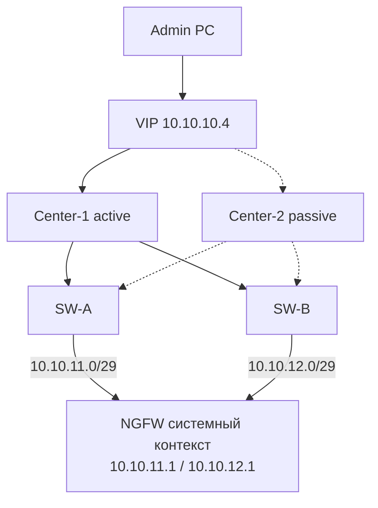

# 2.5. Ideco Center HA + NGFW с dual-homing

**Цель:** отказоустойчивость на двух уровнях: HA-пара Center (2.2) и два пути до каждого NGFW (2.3).

_Адресация на схемах — пример (RFC1918), подставьте свою._

```text
                  Admin PC ---> VIP 10.10.10.4 (пример)
                                    |
              +---------------------+---------------------+
              |                                           |
     +--------+---------+                       +---------+--------+
     | Center-1 active  |                       | Center-2 passive |
     | 10.10.10.5       |                       | 10.10.10.6       |
     +----+--------+----+                       +----+--------+----+
          |        |                                 |        |
          |   +----+---------------------------------+--+     |
          |   |                                         |     |
     +----+---+--+                                 +----+-----+-+
     |   SW-A    |                                 |    SW-B    |
     +-----+-----+                                 +-----+------+
           | 10.10.11.0/29                 10.10.12.0/29 |
     port2 |                                             | port3
           +-----------------+-------------+-------------+
                             | NGFW системный контекст   |
                             | 10.10.11.1 / 10.10.12.1   |
                             +---------------------------+
```



**Что даёт**

- Отказоустойчивость и точки управления, и пути до NGFW.
- Плановые работы на Center или коммутаторе без потери управления.
- Масштабируется на несколько площадок вместе с 2.4.

**Что ломает / риски**

- Максимальная сложность и стоимость.
- Больше точек конфигурации — выше риск ошибки и split-brain.
- Сложнее тестировать все комбинации отказов.

**На что обратить внимание**

- Поддержку HA у Center и работу с двумя адресами NGFW проверьте в документации Ideco.
- Регулярно тестируйте отказы: Center-1, SW-A, SW-B, порт NGFW.
- Oxidized и Redbox API должны ходить на mgmt-IP системного контекста (или на Ideco Center, если он используется как точка интеграции), а не на VCE: с 23.4.40 у VCE закрыты SSH и собственный веб.
- Рекомендуемая схема для нескольких площадок с высокими требованиями к доступности.
